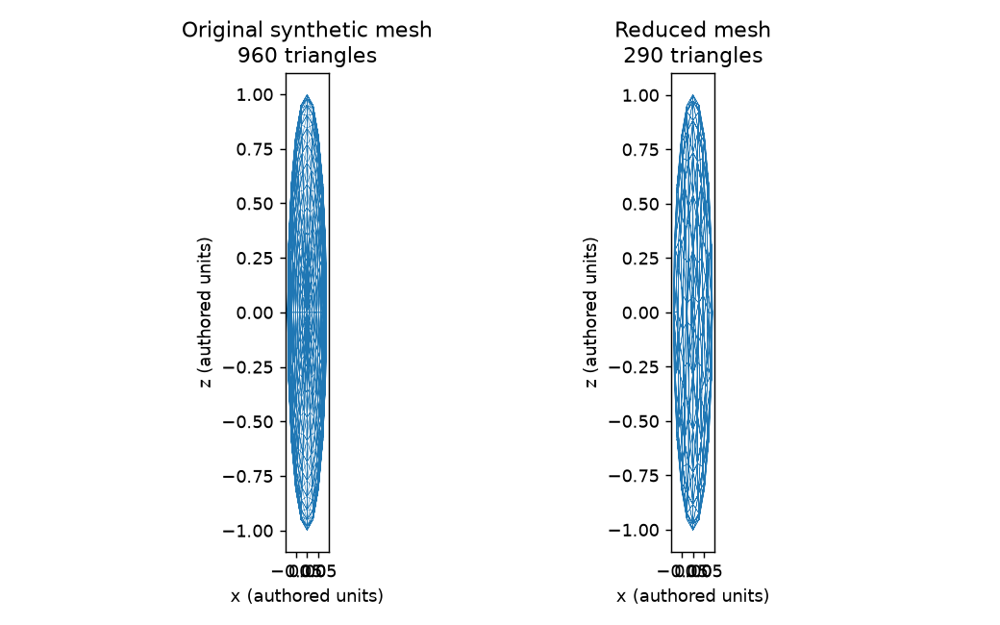

# Blender mesh budget

Reduce a GLB mesh to a triangle budget and check the exported result before replacing the output. The script reimports the result, counts triangles, samples surface error and checks its texture policy.

## Run

Requires Blender on your command path. The example mesh is generated geometry with no external assets.

```sh
blender --background --python-exit-code 1 --python mesh_budget.py -- \
  --source examples/synthetic-fish.glb --output example-output.glb \
  --triangles 300 --max-surface-error-fraction 0.025
```

`--triangles` is a hard cap after export and reimport. Surface error is measured relative to the source bounding-box extent. `--texture-policy preserve_pixels` is the default; `allow_reencode` permits texture reencoding. Output and source must be different files.

If a check fails, the process exits nonzero and keeps the previous output. A successful run writes the reduced GLB and a JSON report beside it. The script was exercised with Blender 5.2.1.



## Check output preservation

```sh
python3 tests/check_blender.py
```

This runs the bundled mesh through an ordinary budget and an intentionally impossible surface-error budget. It verifies that the rejected run leaves the accepted output unchanged. Surface samples are an approximation, not an exact Hausdorff distance. Texture pixel equality does not by itself establish unchanged UV appearance, materials or deformation.

Extracted from [Yellowstone](https://github.com/seris10/yellowstone). Apache-2.0.
